<div align="center">



### Everything Flipper One. One place. Updated as it happens.

**Flipper One** is the pocket-sized, fully open ARM Linux computer from the team behind Flipper Zero.<br>
This is the unofficial community hub: specs, the launch timeline, every official repo, and every project people are already building for it.

<br>

[](https://www.kickstarter.com/projects/flipper-devices/flipper-one)
[](#-timeline)
[](https://github.com/haxdoggy/Flipper-One/stargazers)
[](https://github.com/haxdoggy/Flipper-One/commits)

**[Specs](#-specs)** · **[Timeline](#-timeline)** · **[Try it today](#-try-flipper-os-today)** · **[Official repos](#-official-repositories)** · **[Community projects](#-community-projects)** · **[FAQ](#-faq)** · **[Contribute](#-contributing)**

</div>

> [!TIP]
> **⭐ Star this repo to keep Flipper One on your radar.** The page gets updated every time something drops: new dev logs, campaign milestones, shipping news and fresh community projects. Want a ping on every update? Hit **Watch**.

## ⚡ TL;DR

Flipper One is **not** a Flipper Zero 2. Zero lives at "Layer 0": radio and physical access, with Sub-GHz, NFC, RFID and infrared. One moves up a layer, to **IP networks and real Linux**. It's a pocket computer you can turn into a Wi-Fi router, a leak-proof VPN gateway, an invisible Ethernet sniffer, a 5G hotspot, a LoRa mesh node, a TV box or a full desktop, and switch between them from the boot menu.

- 🧠 **8-core Rockchip RK3576, 6 TOPS NPU, 8 GB RAM.** Raspberry Pi 5-class multi-core performance at lower power.
- 🫀 **Two brains.** An RP2350 co-processor runs the screen, buttons and power, so the device stays usable even when Linux is off.
- 🌐 **2× Gigabit Ethernet, Wi-Fi 6E, Bluetooth 5.2**, plus an **M.2 Key-B** slot for 5G, satellite, SDR, GNSS, NVMe and AI accelerators.
- 🐧 **Mainline first.** Flipper OS is Debian on an upstream kernel, and Collabora is upstreaming RK3576 support. No frozen vendor BSP.
- 🔄 **OS profiles.** Router, desktop, TV media box, minimal: boot, clone and reset entire system setups from the built-in boot menu.
- 🖥️ **A desktop in your pocket.** HDMI 2.1, or a single USB-C cable with DisplayPort Alt Mode, both up to 4K @ 120 Hz.
- 🔋 **0.96 W with Linux running.** That's up to 24 hours on battery.
- 🛠️ **Built in public.** Open docs, open task boards, 11 dev logs so far, and you can help build it.

## 🔥 Latest

- **Nov 18, 2026:** Day two of the campaign: **20,000+ backers** and **€10M+** pledged in roughly 24 hours. That's more than double what Flipper Zero raised in its *entire* 2020 campaign.
- **Nov 17, 2026:** 🟢 **The Kickstarter is live** at $399. It closes Dec 17, and first deliveries are estimated for July 2027.
- **Nov 17, 2026:** [f1emu](https://github.com/VSHT3/flipper-one-emu) boots the real Flipper One OS on a Linux PC in QEMU, no root needed.
- **Nov 15, 2026:** Flipper publishes an official Python library: `pip install flipperone`.
- **Nov 3, 2026:** Pre-orders open: a refundable $20 coupon locks in $379 on Kickstarter.

## 🚀 Launch tracker

| | |
|---|---|
| **Status** | 🟢 **Live on Kickstarter**, Nov 17 → Dec 17, 2026 |
| **Price** | **$399** Kickstarter tier · $379 for pre-order coupon holders · shipping and taxes extra |
| **Estimated delivery** | **July 2027** |
| **Ships to** | US, Canada, UK, Australia, all 27 EU countries, Switzerland, Norway, Singapore and Hong Kong |
| **In the box** | Flipper One and a USB-C cable |
| **Add-on modules** | LoRa (MeshCore, Meshtastic, Reticulum), SDR and a 4G/5G modem. Bundles are on the campaign page |
| **Funding** | Goal smashed on day one, with 20,000+ backers in the first ~24 hours |
| **Price outlook** | Flipper calls $399 a no-margin price, and its pre-order page warns the current price can't hold for the full production run. CEO Pavel Zhovner has said the One needs to sell for around $500 to be sustainable. |

> [!NOTE]
> Crowdfunding means pre-ordering hardware that's still in development. Specs, dates and prices can change, so read the campaign's risks section before you pledge.

## 🎯 What it's built to do

Straight from Flipper's own [feature list](https://docs.flipper.net/one/general/features) and [product page](https://flipper.net/pages/flipper-one):

| | |
|---|---|
| 📶 **Wi-Fi router** | Wired internet in; Wi-Fi 6, a second Ethernet port and USB out |
| 🏨 **Captive-portal sharer** | Join a paid, one-device-only Wi-Fi on one band, run your own access point on another, log in once and share it with every device |
| 🔌 **USB network adapter** | Bridges Wi-Fi or Ethernet to any PC over a single USB-C cable, with no drivers needed |
| 🛡️ **Leak-proof VPN gateway** | WireGuard, IKEv2 and OpenVPN, with DNS and IPv6 leaks blocked for every device behind it |
| 🕵️ **Transparent Ethernet sniffer** | Sits inline between two devices, invisible on the network, and saves PCAPs or streams to Wireshark over USB |
| 🗺️ **LAN discovery** | Listens passively first, then steps up layer by layer: DHCP, VLANs, hosts and services |
| 🔀 **Multi-WAN** | Up to 5 uplinks with failover, load balancing and dynamic routing |
| 📻 **Modules** | LoRa mesh, SDR, 4G/5G, satellite (NTN) and GNSS, plus GPIO add-ons like a VHF walkie-talkie and a pixel-art camera |
| ⚡ **Power meter** | A real-time wattmeter for the whole system, built into the LEDs and readable from Linux |

## 📅 Timeline

| When | Milestone |
|---|---|
| **2020** | 💡 **The idea.** Flipper's original plan had two devices: Zero, and a **"Flipper One"** that would do everything Zero does plus carry an ARM Linux computer for network pentesting. Zero ships first. |
| **Aug 2020** | 📟 Flipper Zero hits Kickstarter, funds in 8 minutes and raises **$4.8M**. It goes on to sell around a million devices. |
| **Jul–Aug 2025** | 🧑‍💻 **Work moves to GitHub.** The first Flipper One repos are created: the RP2350 MCU firmware, the RK3576 Linux build scripts and the docs. |
| **Sep 2025** | 🧩 **First Flipper OS concept**: an immutable root with atomic updates. |
| **Early 2026** | 🔩 First working prototype. |
| **May 21, 2026** | 📣 **The official reveal: ["Flipper One — we need your help."](https://blog.flipper.net/flipper-one-we-need-your-help/)** The Developer Portal opens, Flipper partners with Collabora to mainline the RK3576, and the whole development process goes public. |
| **Jun 2026** | 🌱 The **first community project**, a browser lab for the FlipCTL UI, is featured in Dev Log #4. |
| **Jun → Oct 2026** | 🗒️ **11 public dev logs**: RK3576 hardware video decoding lands in mainline, a new PCB revision, a new body design, the Flipper OS installer, a Linux-based boot menu and **0.96 W** idle power. |
| **Oct 2026** | 💾 **"Run your own Flipper One."** Dev Log #10 shows everyone how to install Flipper OS on off-the-shelf RK3576 boards, with the FlipCTL UI, the App Manager and OS profiles. Yes, Doom runs. |
| **Nov 3, 2026** | 🎟️ **Pre-orders**: a refundable $20 coupon locks in a $379 Kickstarter price. |
| **Nov 17, 2026** | 🟢 **The Kickstarter goes live** at $399 and blows past its goal on day one. |
| **Dec 17, 2026** | ⏳ The campaign ends. |
| **July 2027** *(est.)* | 📦 First deliveries to backers. |
| **TBA** | 🛒 Retail availability. |

## 🔧 Specs

> From the official [tech specs](https://docs.flipper.net/one/general/tech-specs). The device is still in development, and values marked ⚠️ are not final.

| | |
|---|---|
| **CPU** | Rockchip **RK3576**: 4× Cortex-A72 + 4× Cortex-A53, up to 2.2 GHz |
| **GPU** | Arm Mali-G52 MC3: OpenGL ES 3.2, OpenCL 2.1, Vulkan 1.2 |
| **NPU** | **6 TOPS** (INT8), with int4 / int8 / int16 / FP16 / BF16 / TF32 support |
| **Co-processor** | Raspberry Pi **RP2350B**: 2× Cortex-M33 + 2× Hazard3 RISC-V @ 150 MHz, 520 KB SRAM, 16 MB flash. It drives the display, buttons, LEDs and power, even with Linux off |
| **RAM** | **8 GB LPDDR5** ⚠️ (the launch figure; the developer docs still list final RAM as TBD) |
| **Storage** | 64 GB UFS 2.2 + microSD slot |
| **Display** | 2.39″ monochrome LCD, 256 × 144 px, 64 grey levels, Gorilla Glass. Readable in sunlight with the backlight off |
| **Controls** | 5-way D-pad, touchpad with haptics, 5 app buttons (Esc · View · Power · Edit · Run), Back, App Switcher and Push-to-Talk |
| **Wi-Fi & Bluetooth** | **Wi-Fi 6E** 2×2 MIMO on 2.4 / 5 / 6 GHz (MediaTek MT7921AUN, open mainline driver, monitor mode) · Bluetooth 5.2 |
| **Ethernet** | **2× Gigabit** RJ45 (Realtek RTL8211F) |
| **USB** | USB-C1: USB 3.1 + DisplayPort Alt Mode + PD in/out · USB-C2: USB 3.1 host · USB-A: USB 3.1 host |
| **Video out** | HDMI 2.1 (full size, CEC) and DisplayPort 1.4 over USB-C, both up to 4K @ 120 Hz |
| **Audio** | 3.5 mm TRRS (stereo out + mic), Nuvoton NAU8822 codec |
| **Expansion** | **M.2 Key-B** (2230 via extender, 2242, 3042, 3052): PCIe 2.1 x1, USB 2.0/3.1, SATA3, UART, I²C, serial audio and SIM |
| **Cellular** | Built-in eSIM and a Nano-SIM slot, both wired to the M.2 port (bring a 4G/5G modem) |
| **GPIO** | 2.54 mm header with MCU and CPU pins (UART, I²C, SPI, CAN, PWM, ADC), 3.3 V and 5 V rails (2 A eFuse) and USB 2.0. Explore it in the [interactive pinout](https://hypery11.github.io/flipper-one-pinout/) |
| **Battery** | 24 Wh two-cell Li-ion (~7,000 mAh ⚠️), USB-C PD charging and a built-in power meter |
| **Battery life** | Linux idle: 0.96 W, **~24 h** · MeshCore node: 1.1 W, ~21.8 h · smart home server: 1.5 W, ~16 h · web browsing: 2.5 W, ~9.6 h · Wi-Fi router: 4.5 W, ~5.3 h |
| **Size & weight** | 155 × 67 × 40 mm · weight TBD ⚠️ |
| **Build** | PC/ABS body, anodized aluminium heatsink and bracket, TPE bumpers, lanyard loop |
| **Debug** | Debug port for both the MCU (SWD + UART) and the CPU (UART), and an official RP2350-based Debug Probe |
| **Software** | **Flipper OS** (Debian-based, mainline kernel), the **FlipCTL** UI, an App Manager and OS profiles |

## 🆚 One vs Zero

| | Flipper Zero | Flipper One |
|---|---|---|
| **Focus** | "Layer 0": radio and physical access | "Layer 1": IP networking, Linux workloads, modular hardware |
| **Brain** | STM32WB55 microcontroller | 8-core RK3576 + RP2350 co-processor |
| **OS** | Custom firmware on FreeRTOS | Flipper OS: Debian on mainline Linux |
| **Built-in radios** | Sub-GHz, NFC, 125 kHz RFID, infrared, Bluetooth LE | Wi-Fi 6E, Bluetooth 5.2, plus 2× Gigabit Ethernet |
| **Expansion** | GPIO modules | M.2 (5G, SDR, satellite, NVMe, AI…) + GPIO |
| **Screen** | 128 × 64 monochrome | 256 × 144, 64 grey levels |
| **Relationship** | Stays in the lineup | A companion, not a replacement: Flipper is keeping both lines |

## 🧰 Try Flipper OS today

> **No need to wait for July 2027.** Flipper OS, the OS that ships on Flipper One, already runs on off-the-shelf RK3576 boards and in emulators. Get a head start now.

### 1 · Flash it onto an RK3576 board

| Board | Target | Notes |
|---|---|---|
| Armsom Sige5 / Banana Pi BPI-M5 Pro | `sige5` | ⭐ Recommended by Flipper |
| FireFly ROC-RK3576-PC | `rock-pc` | |
| Luckfox Omni3576 | `omni3576` | |
| Radxa ROCK 4D | `rock-4d` | No DisplayPort over USB-C; flashing needs a USB-A to USB-A cable |
| FriendlyElec NanoPi M5 | `nanopi-m5` | No DisplayPort over USB-C; flashing needs a USB-A to USB-A cable |
| 100ASK DshanPi A1 | (community) | Works with [these fix-up scripts](https://github.com/UdalovIvanw/DshanPi-FlipperOS-linux-scripts) |

1. Download the image for your target from the [official image server](https://dl-linux-images.flipp.dev/full-img/).
2. Flash it to a microSD card (8 GB or larger) with [Raspberry Pi Imager](https://www.raspberrypi.com/software/) → **Use custom**.
3. Boot the board on your LAN and open **`http://<board-ip>:8899`**. FlipCTL, the App Manager and every OS profile (Desktop, Router, TV Media Box, Minimal…) are right there.

If your board already has an OS on its eMMC, the walkthrough has one extra step so it boots from the microSD card.

Full walkthrough: **[Dev Log #10: Run your own Flipper One](https://docs.flipper.net/one/dev-log/10)** · Other install methods: [How to install a Linux image](https://docs.flipper.net/one/cpu-software/how-to-install-linux-image)

> [!TIP]
> The App Manager already has **21 apps** in the [official catalog](https://github.com/flipperdevices/flipctl-apps), including Doom, an FPV receiver, a USB analyzer, an Ethernet tester, a speed test, a web browser, a video player, and Python and JavaScript runtimes.

### 2 · Run it on your computer

| Project | Runs on | What you get |
|---|---|---|
| [qemu-flipperos](https://github.com/Gelules/qemu-flipperos) | Linux | Boots official Flipper OS builds in QEMU, with FlipCTL in your browser plus SSH and a console |
| [f1emu](https://github.com/VSHT3/flipper-one-emu) | Linux | The official image in QEMU without root, with a remote view of the device |
| [Flipper One VM](https://github.com/plusmalias/flipper-one-vm) | Intel Mac | Official FlipperOS under QEMU: live front-panel UI, SSH, KDE desktop, a VMware build and an app dev loop |
| [Flipper One Mac Demo](https://github.com/Nirbhik-Acharya-official/flipper-one-mac-demo) | Apple Silicon | A native macOS app with a Flipper OS VM and a FlipCTL viewer (Doom included) |
| [Flipper One UI Lab](https://github.com/kalicyh/flipperone-lab) | Docker | A container lab for the public userspace and the FlipCTL UI harness, listed by Flipper |
| [Flipper One Simulator](https://github.com/kai9987kai/FLIPPER-ONE-SIMULATOR) | Any browser | A single-file *behavioural* simulator. Not the real OS, but zero setup |

### 3 · Write your first app

- **FlipCTL apps** are ordinary Wayland clients, and FlipCTL puts their frames on the 256×144 panel. Build with the `flipctl-app` Rust framework (copy `apps/hello` to start) or wrap a script. Start here: [How to write an app](https://github.com/flipperdevices/flipctl-slint/blob/HEAD/docs/apps.md).
- **Python:** [flipperone-python](https://github.com/flipperdevices/flipperone-python) is the official library for the MCU's CLI, Linux over SSH, the Debug Probe and the USB bootloaders.
- **Learn from real apps:** [Bad Apple!!](https://github.com/Gelules/flipperone-bad-apple) (Python scripts for FlipCTL) and [Dolphone](https://github.com/isaacrowntree/dolphone) (Rust FlipCTL apps plus a ModemManager daemon).

```bash
pip install flipperone          # the MCU and the Debug Probe over serial
pip install 'flipperone[ssh]'   # plus Linux over SSH
```

## 🌐 Official resources

**Start here**
- [Flipper One product page](https://flipper.net/pages/flipper-one)
- [Kickstarter campaign](https://www.kickstarter.com/projects/flipper-devices/flipper-one)
- [Developer Portal](https://docs.flipper.net/one): hardware, Linux, MCU firmware, UI and testing docs
- [Dev Log](https://docs.flipper.net/one/dev-log): regular development updates
- [Tech specs](https://docs.flipper.net/one/general/tech-specs) · [Features and user stories](https://docs.flipper.net/one/general/features)

**Get involved**
- [How to join](https://docs.flipper.net/one/how-to-join): how the sub-projects are organised
- [Open tasks](https://docs.flipper.net/one/open-tasks): things you can pick up today
- [Task boards](https://github.com/orgs/flipperdevices/projects): a GitHub Project for every sub-project
- [Community projects](https://docs.flipper.net/one/community): Flipper's own list, open to pull requests

**Deep dives from the team**
- [Flipper One — we need your help](https://blog.flipper.net/flipper-one-we-need-your-help/): the May 2026 reveal
- [Flipper OS — the operating system for Flipper One](https://blog.flipper.net/flipper-os-the-operating-system-for-flipper-one/)
- [FlipCTL — our GUI framework for embedded Linux systems](https://blog.flipper.net/flipctl-our-gui-framework-for-embedded-linux-systems/)
- [RK3576 mainline support](https://docs.flipper.net/one/cpu-software/rk3576-mainlining) · [Collabora × Flipper: opening up the RK3576](https://www.collabora.com/news-and-blog/news-and-events/collabora-flipper-opening-up-the-rk3576.html) · [Collabora's mainline status tracker](https://gitlab.collabora.com/hardware-enablement/rockchip-3588/notes-for-rockchip-3576/-/blob/main/mainline-status.md)

**Follow**
- [Discord](https://discord.com/invite/flipper) · [@Flipper_RND on X](https://x.com/Flipper_RND) (Flipper One dev updates) · [@flipper_net on X](https://x.com/flipper_net) · [Flipper blog](https://blog.flipper.net)

## 📦 Official repositories

> Everything is developed in the open at [github.com/flipperdevices](https://github.com/flipperdevices).

| Repository | ★ | What's inside |
|---|---|---|
| **📚 Docs & design** | | |
| [flipperone-docs](https://github.com/flipperdevices/flipperone-docs) |  | Sources of the Developer Portal: specs, guides and dev logs |
| [flipperone-hardware](https://github.com/flipperdevices/flipperone-hardware) |  | The hardware sub-project, with public PCB schematics and layouts in Altium 365 |
| [flipperone-mechanics](https://github.com/flipperdevices/flipperone-mechanics) |  | Enclosure 3D models and the module mounting system. Community module models are welcome |
| [flipperone-ui](https://github.com/flipperdevices/flipperone-ui) |  | The UI & graphics sub-project: the Figma asset library and design tasks |
| **🐧 Linux side (RK3576)** | | |
| [flipperone-linux-build-scripts](https://github.com/flipperdevices/flipperone-linux-build-scripts) |  | Build scripts for Flipper OS images on RK3576 boards |
| [flipper-linux-kernel](https://github.com/flipperdevices/flipper-linux-kernel) |  | Flipper's Linux kernel tree |
| [u-boot](https://github.com/flipperdevices/u-boot) |  | Flipper's U-Boot tree |
| [flipperos-installer](https://github.com/flipperdevices/flipperos-installer) |  | A Rust installer that runs from RAM and installs Flipper OS and its profiles over the network |
| [flipperos-installer-initramfs](https://github.com/flipperdevices/flipperos-installer-initramfs) |  | The Buildroot recipe for the installer's initramfs |
| [flipperos-boot-menu](https://github.com/flipperdevices/flipperos-boot-menu) |  | The boot menu image, for picking, cloning and resetting OS profiles |
| [flipperos-recovery](https://github.com/flipperdevices/flipperos-recovery) |  | The recovery image |
| [flipperos-btrfs-tools](https://github.com/flipperdevices/flipperos-btrfs-tools) |  | Tools behind the Btrfs-based OS profile system |
| **🎨 UI & apps** | | |
| [flipctl](https://github.com/flipperdevices/flipctl) |  | FlipCTL, the UI framework for embedded and headless Linux: vision and architecture |
| [flipctl-slint](https://github.com/flipperdevices/flipctl-slint) |  | The Slint implementation of the Flipper One UI, plus the app framework |
| [flipctl-apps](https://github.com/flipperdevices/flipctl-apps) |  | The catalog the App Manager installs from |
| [flipctl-fonts](https://github.com/flipperdevices/flipctl-fonts) |  | Pixel fonts for the 256×144 UI |
| **🕹️ MCU & tooling** | | |
| [flipperone-mcu-firmware](https://github.com/flipperdevices/flipperone-mcu-firmware) |  | RP2350 co-processor firmware: display, buttons, LEDs, power and boot control |
| [flipperone-mcu-protobuf](https://github.com/flipperdevices/flipperone-mcu-protobuf) |  | Protobuf definitions of the MCU RPC protocol |
| [flipperone-debug-probe](https://github.com/flipperdevices/flipperone-debug-probe) |  | Firmware for the RP2350-based Debug Probe, which debugs both MCU and CPU |
| [flipperone-python](https://github.com/flipperdevices/flipperone-python) |  | The official Python library: `pip install flipperone` |
| [flipperone-testing](https://github.com/flipperdevices/flipperone-testing) |  | Test suites for RK3576 boards, including the FlipCTL UI test harness |

## 🧪 Community projects

> People are building for a device that hasn't shipped yet. Here's everything worth your time. Emulators and VMs are listed under [Try it today](#-try-flipper-os-today).

### Apps & tools
- **[Dolphone](https://github.com/isaacrowntree/dolphone)**: turns Flipper One into a phone. Calls, texts, emergency alerts, contacts and a call log through an M.2 cellular modem, as FlipCTL apps on the panel, a desktop app in desktop mode and `phonectl` in the shell. *by isaacrowntree*
- **[Flipper One KVM](https://github.com/thinkelastic/flipper-kvm)**: KVM over IP. Flipper One captures a computer's HDMI output and acts as its keyboard, mouse and USB drive, so you can rescue a machine from your browser, BIOS included. *by thinkelastic*
- **[Bad Apple!! on Flipper One](https://github.com/Gelules/flipperone-bad-apple)**: the legendary demo at 30 fps on the 256×144 panel, in greyscale and 1-bit. *by Gelules*
- **[Flippergotchi](https://github.com/haroldboom/flippergotchi)**: a Tamagotchi-style Wi-Fi pet RPG for Flipper One, playable in simulation today. *by haroldboom*

### Companions & remote control
- **[FlipDeck](https://github.com/jplongley-prog/flipdeck)**: a desktop companion for Windows and Linux with an SSH console and an SFTP file browser. FlipCTL control is on the roadmap. *by jplongley-prog*
- **[FlipCTL for CardputerZero](https://github.com/whywilson/CardputerZeroFlipCtrl)**: mirror and drive Flipper One's screen from a CardputerZero over Ethernet or Wi-Fi. *by whywilson*
- **[Pledge Meter](https://github.com/ddiepri/pledge-meter)**: live Kickstarter stats for the campaign on a BUSY Bar, next to a pixel Flipper One. *by ddiepri*

### OS & FlipCTL experiments
- **[flipper-profile](https://github.com/NetVar1337/flipper-profile)**: bootable OS profiles as Btrfs subvolumes plus OverlayFS, a working take on a Flipper OS RFC. *by NetVar1337*
- **[flipper-os-lab](https://github.com/xbizzybone/flipper-os-lab)**: reproduces the Flipper OS storage architecture RFC (dm-verity, Btrfs, OverlayFS) on loop devices, no board needed. *by xbizzybone*
- **[flipctld](https://github.com/NetVar1337/flipctld)**: a dependency-free C11 implementation of the FlipCTL menu UI core, driven by JSON app manifests. *by NetVar1337*
- **[flipper-os (OSTree edition)](https://github.com/chubuchnyi/flipper-os)**: an OSTree + OverlayFS interpretation of the Flipper OS profile concept. *by chubuchnyi*

### Firmware forks
- **[RogueMaster Flipper One MCU firmware](https://github.com/RogueMaster/flipperone-mcu-firmware)**: a community fork of the RP2350 firmware from the maintainer of the RogueMaster Flipper Zero firmware. *by RogueMaster*

### Hardware helpers
- **[Flipper One Pinout](https://hypery11.github.io/flipper-one-pinout/)**: an interactive GPIO header and M.2 pinout with protocol filters for I²C, UART, SPI, CAN, PCIe and more ([source](https://github.com/hypery11/flipper-one-pinout)). *by hypery11*

### Other RK3576 boards & DIY
- **[DshanPi Flipper OS scripts](https://github.com/UdalovIvanw/DshanPi-FlipperOS-linux-scripts)** and **[U-Boot](https://github.com/UdalovIvanw/dshanpi-A1-defconfig)**: run Flipper OS on the 100ASK DshanPi A1. *by UdalovIvanw*
- **[RK3576 cyberdeck](https://github.com/UdalovIvanw/rk3576-cyberdeck)**: a DIY clamshell cyberdeck built from off-the-shelf parts and inspired by Flipper One. *by UdalovIvanw*

### Local AI on the RK3576 NPU
> The NPU is one of the last big gaps in mainline RK3576 support. These projects are attacking it.

- **[linux-rk3576-npu](https://github.com/gahingwoo/linux-rk3576-npu)**: a mainline kernel bring-up for the RK3576 NPU that runs Llama-3.2-1B at 4-bit on the NPU at ~18 tokens/s (tested on a Radxa ROCK 4D). *by gahingwoo*
- **[charsiu](https://github.com/gahingwoo/charsiu)**: an open LLM runtime for the RK3576 NPU on the mainline `rocket` driver, with no vendor userspace. *by gahingwoo*

**Built something?** [Submit it](https://github.com/haxdoggy/Flipper-One/issues/new?template=submit-project.yml). It takes a minute.

## 🎬 Watch

- [Flipper OS on an off-the-shelf RK3576 board](https://youtu.be/QENMEUr5oPo), from Dev Log #10
- [The new boot menu and OS profile switching](https://youtu.be/aLRK_TnJwuA), from Dev Log #9
- [The portable Flipper One DevKit](https://youtu.be/-ymIQCeVVhc), from Dev Log #9

## 📰 Press

- [CNX Software](https://www.cnx-software.com/2026/11/18/flipper-one-a-rockchip-rk3576-powered-portable-arm-linux-computer-and-networking-multi-tool/): the most detailed spec breakdown, updated for the Kickstarter
- [BleepingComputer](https://www.bleepingcomputer.com/news/hardware/flipper-devices-launches-399-flipper-one-linux-based-multi-tool/): the $399 launch
- [TechSpot](https://www.techspot.com/news/114601-flipper-one-blows-past-kickstarter-goal-24-hours.html): €10M+ in 24 hours
- [heise](https://www.heise.de/en/news/Record-Breaking-Crowdfunding-Flipper-One-Available-to-Preorder-on-Kickstarter-11528918.html): record-breaking crowdfunding
- [Hardware Busters](https://hwbusters.com/news/flipper-one-kickstarter-opens-at-399-and-the-hacker-gadget-has-turned-into-a-pocket-linux-router/): pricing, and what's still missing in mainline
- [The Register](https://www.theregister.com/personal-tech/2026/05/21/flipper-one-wants-to-be-the-linux-multi-tool-in-your-pocket/5244165): the May reveal
- [Liliputing](https://liliputing.com/flipper-one-is-a-pocket-sized-linux-computer-and-network-hacking-tool/): first look
- [RTL-SDR.com](https://www.rtl-sdr.com/?p=65983): the SDR angle
- [Hackaday](https://hackaday.com/tag/flipper-one/): everything tagged Flipper One

## ❓ FAQ

<details>
<summary><b>Is Flipper One a Flipper Zero 2?</b></summary>
<br>

No, and Flipper is keeping both. Zero works at "Layer 0": radio and physical access with Sub-GHz, NFC, RFID and infrared. One works a layer up, on IP networking, Linux workloads and modular hardware. They're designed to complement each other.

</details>

<details>
<summary><b>Does it have NFC, RFID or Sub-GHz?</b></summary>
<br>

Not built in. Radios come in through expansion instead: the M.2 slot (SDR, cellular, satellite, GNSS) and add-on modules like LoRa or the GPIO walkie-talkie.

</details>

<details>
<summary><b>When does it ship, and how much is it?</b></summary>
<br>

It's $399 on Kickstarter (Nov 17 – Dec 17, 2026), with shipping and taxes extra. First deliveries are estimated for July 2027, and there's no retail date yet.

</details>

<details>
<summary><b>Can I run my own Linux distro?</b></summary>
<br>

That's the point of going mainline: any distro that ships a recent enough kernel should work. Today mainline mostly works on the RK3576. The NPU, hardware video encoding, the CSI camera and PCIe suspend are still in progress, and DDR training still relies on a Rockchip binary. Track it on the [mainline support page](https://docs.flipper.net/one/cpu-software/rk3576-mainlining).

</details>

<details>
<summary><b>How open is it, really?</b></summary>
<br>

Very. The docs, MCU firmware, Linux build scripts, kernel and U-Boot trees, UI framework, enclosure models and test suites are all public on GitHub. The PCB designs are viewable in Altium 365, and development runs on public task boards. The stated goal is a device with no binary blobs.

</details>

<details>
<summary><b>Can I develop for it before it ships?</b></summary>
<br>

Yes. See [Try Flipper OS today](#-try-flipper-os-today): flash an RK3576 board, or run Flipper OS in QEMU on your own machine.

</details>

<details>
<summary><b>Can I help build it?</b></summary>
<br>

Yes. Flipper keeps a list of [open tasks](https://docs.flipper.net/one/open-tasks) across hardware, Linux, MCU firmware, UI, docs and testing.

</details>

<details>
<summary><b>Is this repo official?</b></summary>
<br>

No. It's community-maintained and not affiliated with Flipper Devices.

</details>

## 🤝 Contributing

This list lives on contributions. Found a project, guide, video or news story we missed?

- **Quickest:** open an issue with the [Submit a project](https://github.com/haxdoggy/Flipper-One/issues/new?template=submit-project.yml) form.
- **Direct:** send a pull request. See [CONTRIBUTING.md](CONTRIBUTING.md).
- **Spec or date changed?** Use the [News or spec update](https://github.com/haxdoggy/Flipper-One/issues/new?template=news-or-spec-update.yml) form.

What makes the cut: it's about Flipper One, Flipper OS, FlipCTL, or RK3576 work that matters for Flipper One. It has a real README, and the source is public. No prebuilt binaries from unverified sources, no malware, nothing illegal.

## ⭐ Star history

<a href="https://star-history.com/#haxdoggy/Flipper-One&Date">
  <picture>
    <source media="(prefers-color-scheme: dark)" srcset="https://api.star-history.com/svg?repos=haxdoggy/Flipper-One&type=Date&theme=dark">
    
  </picture>
</a>

---

<sub>**Disclaimer:** This is an unofficial, community-maintained project. It is not affiliated with, endorsed by or sponsored by Flipper Devices Inc. "Flipper", "Flipper One" and "Flipper Zero" are trademarks of their respective owners. Specs, prices and dates come from public sources and may change, so always check the official [Developer Portal](https://docs.flipper.net/one). Community projects are listed as-is and are not audited: read the code before you run it, and only test networks and devices you're authorized to test.</sub>

<div align="center">
<sub>Maintained by <a href="https://github.com/haxdoggy">haxdoggy</a> · If this page helped you, <b>⭐ star it</b> so the next person finds it too.</sub>
</div>
